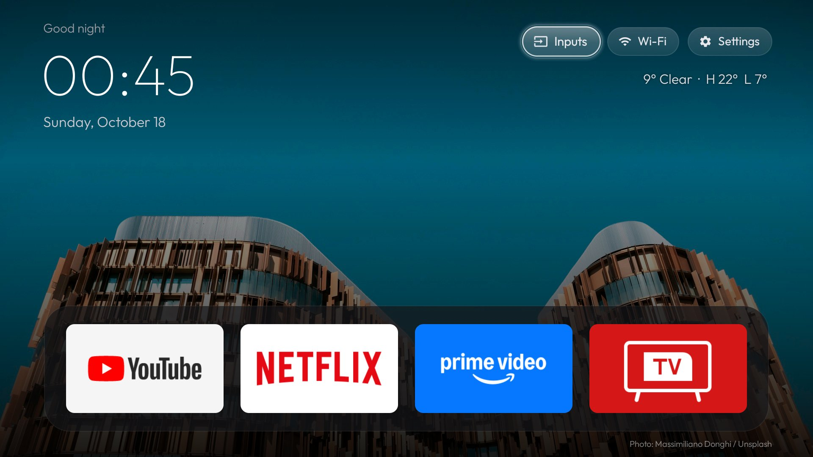
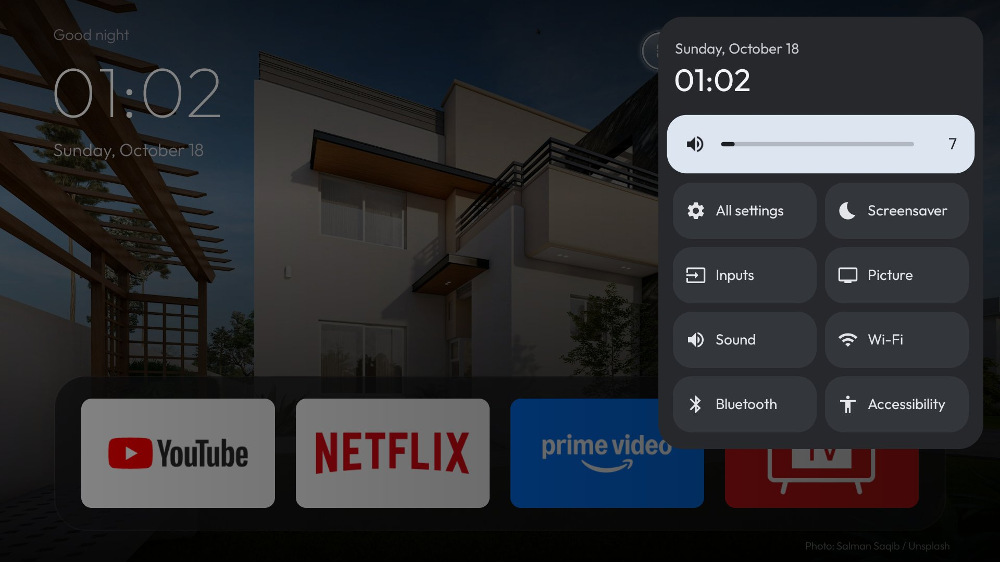

# tv-launcher

[](https://github.com/zhengnanli/tv-launcher/actions/workflows/build.yml)

A small, quiet home screen for Android TV / Google TV: a dock of four apps in a rounded
band, the rest in a 4-column grid below it, one glass highlight that springs between tiles,
frosted pills for Inputs, Wi-Fi and Settings, and a quick settings panel on the remote's
gear key.





Built for a TCL Google TV (Android 12, 1 GB class RAM): no blur, no video, and photos and
weather refresh only while the home screen is visible.

```sh
adb connect <tv-ip>:5555
./install.sh            # build, install, set as home, disable the stock launcher
./install.sh --restore  # give HOME back to the stock launcher
```

Every push to `main` is built by GitHub Actions (the APK is under the run's **Artifacts**);
a `v*` tag also publishes it as a release download. Builds are release builds, shrunk and
optimised by R8, and signed with `SIGNING_KEYSTORE` / `SIGNING_PASSWORD` (CI: repository
secrets; locally: the environment or `~/.config/tv-ambient/signing.env`), so local and CI
builds install over each other. Without a key, `build.sh` falls back to a debug key.

`build.sh` needs a JDK and the Android SDK (`platforms;android-34`, `build-tools;34.0.0`);
it fetches RecyclerView and its AndroidX dependencies (and R8) from Google's Maven
repository. No Gradle.

- **Dock:** the packages in `HomeActivity.DOCK`, left to right.
- **Keys:** Up/Down move one row; Up from the dock reaches the top bar; the ends of the top
  bar and of each row stop. The last focused tile is remembered.
- **Inputs:** HDMI ports, AV (when the TV registers one) and Live TV, from the TV input
  framework.
- **Settings pill:** a dropdown for Background (Photos or Black), Photo theme (the ambient
  screensaver's themes), how often the photo changes, Weather on/off and °C/°F, plus a row
  for the TV's own settings. Left/Right change a value.
- **Photos and weather:** Unsplash by theme (Bing's photo of the day without a key) and an
  Open-Meteo line under the pills. Both refresh only while home is on screen. The
  Unsplash key and `lat`/`lon` come from `config.json` in the app's files dir on the TV
  (`/sdcard/Android/data/com.ambient.launcher/files/`), pushed over adb.
- **Rearranging:** hold OK (or press Menu) on an app, move it with the arrows, OK to drop.
  Within the dock or grid it slides; across them it swaps, so the dock stays full.
- **Back:** from the grid or top bar returns to the dock; on the dock starts the screensaver.
- **Gear key → quick settings:** a panel like Google TV's (time, volume, All settings,
  Screensaver, Inputs, Picture, Sound, Wi-Fi, Accessibility, Bluetooth) that opens over
  whatever is playing, HDMI included. The firmware opens the Settings app on that key before
  any app can intercept it, so `GearService` (an accessibility service that only watches
  which window is in front) closes Settings and opens the panel; Settings flashes briefly.
- **Wi-Fi name:** Android reveals it only to apps with location permission (`install.sh`
  grants it) and only while Location is on.

Typeface: [Outfit](https://github.com/Outfitio/Outfit-Fonts), SIL Open Font License
(`assets/fonts/OFL.txt`). Pill icons: Material Icons, Apache License 2.0.

MIT License; see `LICENSE`.
